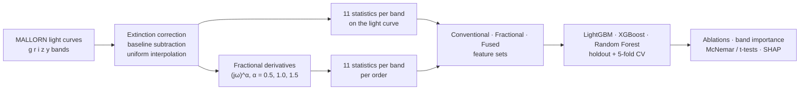
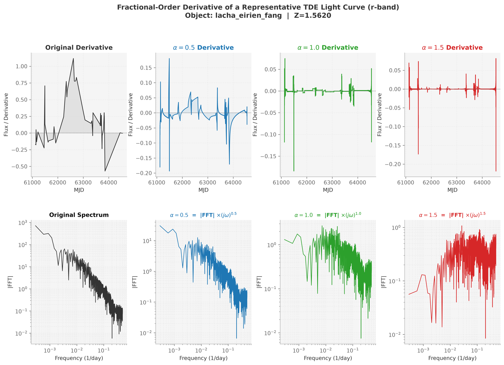
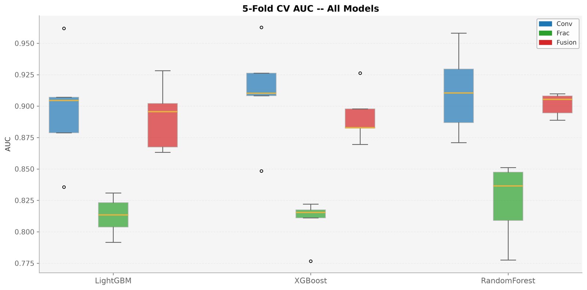
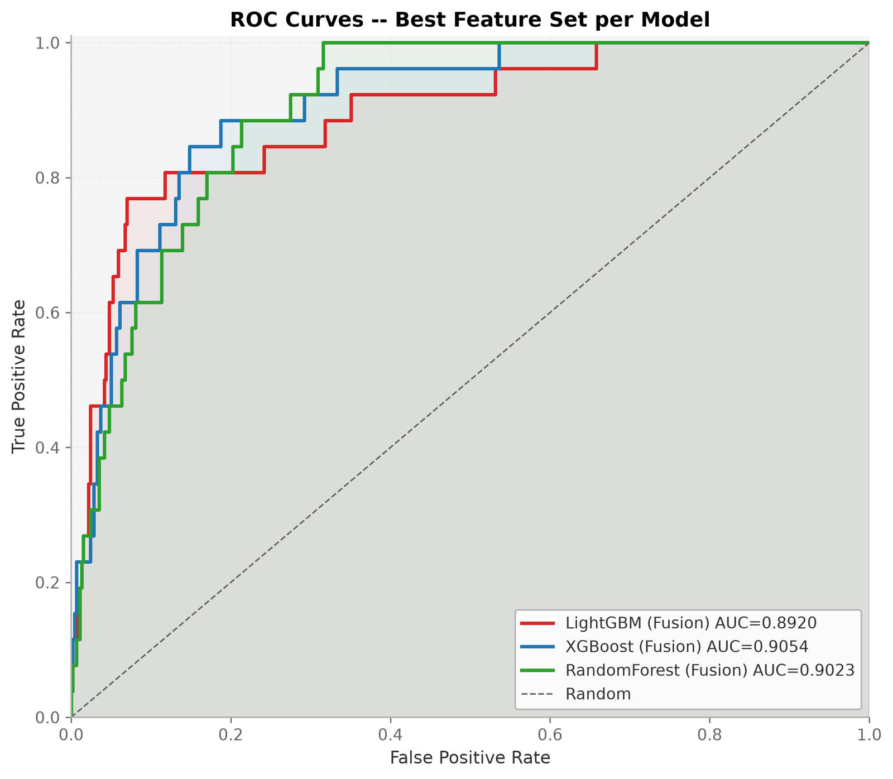
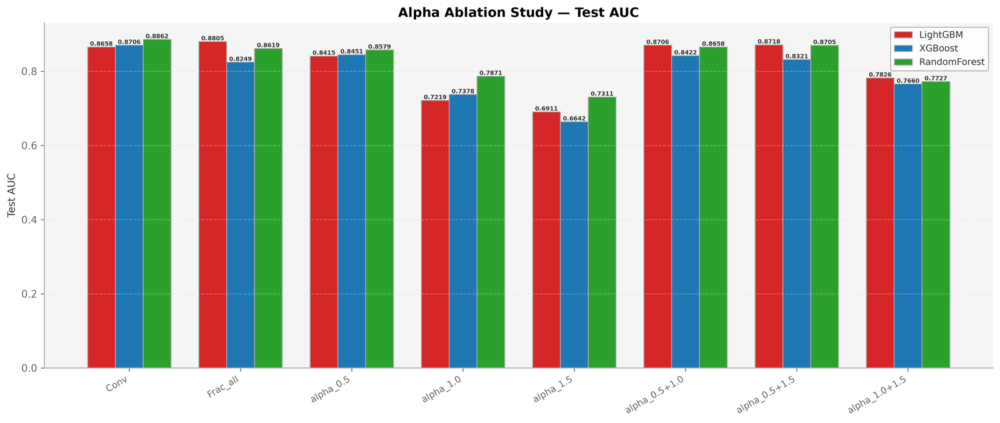
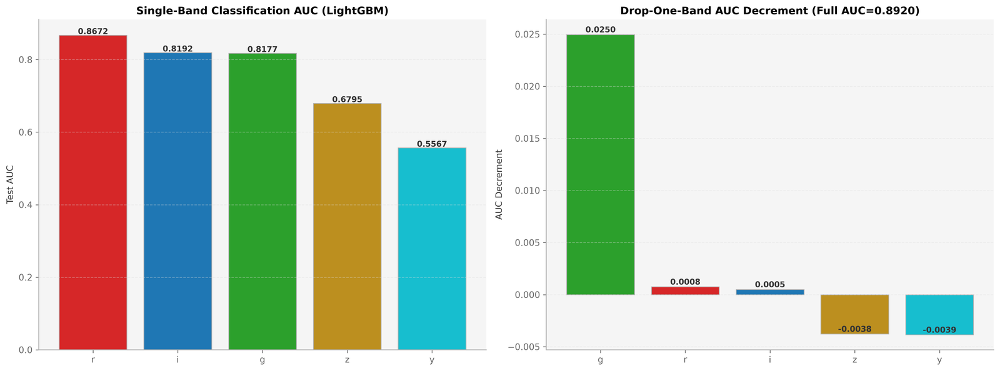
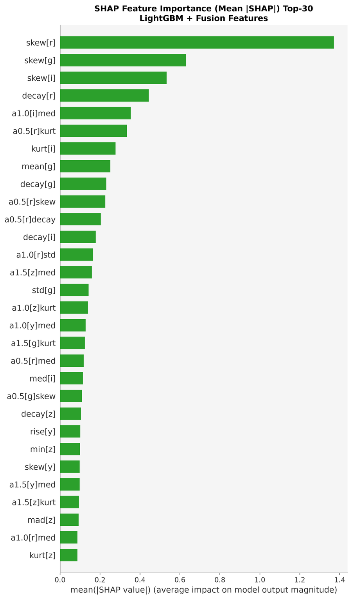

# Fractional-Order Features for TDE Light-Curve Classification

**English** | [简体中文](README.zh-CN.md)

Research code from my undergraduate thesis, *基于分数阶微分的核瞬变源光变曲线特征提取与分类研究*
(Feature extraction and classification of nuclear-transient light curves based on fractional-order
differentiation, 2026).

**Question.** Tidal disruption events (TDEs), where a star is torn apart by a massive black hole,
are rare among nuclear transients, which makes photometric classification an imbalanced-learning
problem. Can fractional-order derivatives of a light curve capture temporal structure, such as
rise and decay shape, that conventional summary statistics miss?

**Approach.** On the simulated LSST light curves of the MALLORN data set, each band's light curve
is extinction-corrected, baseline-subtracted and interpolated onto a uniform grid. Eleven
statistics (moments, amplitude, rise and decay time and others) are computed on the curve itself
and on its fractional derivatives of order α ∈ {0.5, 1.0, 1.5}, computed in the frequency domain
as `(jω)^α`. LightGBM, XGBoost and Random Forest are compared on conventional, fractional and
fused feature sets, followed by ablations, statistical tests and SHAP analysis.

**Finding, in short.** Fused features give the best held-out AUC for all three models, and
fractional features appear among the most important features in SHAP analysis. Under five-fold
cross-validation, however, conventional features alone do as well as the fused set, so the
added value of fractional features is not yet established. A November 2026 reproduction with
current library versions confirms the headline result but not every ablation finding (see
[Results](#results)).





*A representative TDE light curve (r band) and its fractional derivatives. Higher orders amplify
high-frequency structure, while α = 0.5 keeps more of the slow rise and decay.*

## Results

After cleaning, 2,423 of the 3,043 labelled objects have usable light curves (5.4% TDEs). The u
band is dropped because more than 80% of its features are missing, leaving five bands. All
results use a stratified 80/20 holdout split (485 test objects, 26 TDEs) and five-fold
stratified cross-validation, with random seed 42.

### Thesis results and reproduction

The thesis results were produced in May 2026. In November 2026 the same scripts (unchanged code)
were rerun on the same data with current library versions, pinned in
[`requirements-lock.txt`](requirements-lock.txt). LightGBM numbers unless stated otherwise.

| Finding | Thesis (May 2026) | Reproduction (Nov 2026) | Holds? |
| --- | --- | --- | --- |
| Fused features: accuracy / AUC | 94.02% / 0.8850 | 94.43% / 0.8920 | Yes |
| Fusion lowers the spread of 5-fold CV AUC versus conventional features | std ≈ 0.09 → ≈ 0.03 | std 0.041 → 0.024 | Yes, smaller effect |
| No significant difference between the three models (McNemar, fused features) | p > 0.05 | p ≥ 0.45 | Yes |
| Best fractional subset: α = 0.5 + 1.0 (110 features) beats all three orders (165) | AUC 0.8953 vs 0.8869 | AUC 0.8706 vs 0.8805 | No: all three orders are best |
| Removing the r band costs the most AUC | −0.0361 | −0.0008; removing g costs −0.0250 | No |
| r is the strongest single band | Yes | Yes (AUC 0.8672) | Yes |

The code is identical, so the differences most likely come from the environment: library
versions change tree construction and may also change row ordering, and with it the holdout split. With only 26 TDEs in the
test set, a few objects can move AUC by 0.01–0.03, so single-split ablation differences of this
size should not be read as conclusive.

### Holdout and cross-validation (reproduction)

| Model | Feature set | Features | Holdout AUC | 5-fold CV AUC (mean ± std) |
| --- | --- | ---: | ---: | ---: |
| LightGBM | Conventional | 55 | 0.866 | 0.898 ± 0.041 |
| LightGBM | Fractional | 165 | 0.881 | 0.813 ± 0.014 |
| LightGBM | **Fused** | 220 | **0.892** | 0.891 ± 0.024 |
| XGBoost | Conventional | 55 | 0.871 | 0.911 ± 0.037 |
| XGBoost | Fractional | 165 | 0.825 | 0.809 ± 0.016 |
| XGBoost | **Fused** | 220 | **0.905** | 0.892 ± 0.019 |
| Random Forest | Conventional | 55 | 0.886 | 0.911 ± 0.031 |
| Random Forest | Fractional | 165 | 0.862 | 0.824 ± 0.028 |
| Random Forest | **Fused** | 220 | **0.902** | 0.901 ± 0.008 |

Fused features win on the holdout split for every model, but conventional features match or
exceed them in cross-validation. A repeated or nested evaluation with more TDEs is the natural
next step before claiming a gain from fractional features.

<table>
<tr>
<td></td>
<td></td>
</tr>
<tr>
<td><em>Five-fold CV AUC per model for conventional, fractional and fused features.</em></td>
<td><em>Holdout ROC curves, best feature set per model.</em></td>
</tr>
</table>

### Ablations and interpretability (reproduction)



*Holdout AUC by fractional order. α = 0.5 carries most of the signal on its own; α = 1.0 and 1.5
alone are much weaker.*



*Left: AUC from a single band. Right: AUC lost when one band is removed from the fused set.*



*Mean |SHAP| for LightGBM on fused features. Skewness of the r, g and i light curves dominates,
followed by a mix of conventional decay-time features and fractional features (prefix `a0.5`,
`a1.0`, `a1.5`).*

## Repository structure

```text
.
├── scripts/
│   ├── run_experiments.py         # Main model comparison and error analysis
│   ├── run_ablation_analysis.py   # Alpha, band, threshold, and statistical analyses
│   ├── run_interpretability.py    # Fractional examples, correlations, and SHAP
│   ├── 00_preprocess.py           # Standalone staged preprocessing utility
│   ├── 01_eda.py                  # EDA based on staged preprocessing output
│   └── 02_feature_extraction.py   # Experimental GL fractional feature extractor
├── archive/                        # Earlier experimental scripts for provenance
├── result/                         # Generated outputs; only its README is tracked
├── DATA.md                         # Data source, layout, and validation instructions
├── CITATION.cff                    # Citation metadata
├── LICENSE                         # Current reuse terms
├── docs/figures/                   # Figures from the November 2026 reproduction
├── requirements.txt                # Python dependencies (lower bounds)
└── requirements-lock.txt           # Exact environment of the reproduction
```

## Installation

Use a 64-bit installation of Python 3.10 or later. Run all commands from the repository root.

```bash
python -m venv .venv
```

Windows PowerShell:

```powershell
.venv\Scripts\Activate.ps1
python -m pip install --upgrade pip
python -m pip install -r requirements.txt
```

macOS or Linux:

```bash
source .venv/bin/activate
python -m pip install --upgrade pip
python -m pip install -r requirements.txt
```

The experiments load the complete light-curve data, train several models in parallel, and generate high-resolution figures. Ensure that the machine has sufficient memory, disk space, and execution time.

## Data setup

This project uses the MALLORN Astronomical Classification Challenge data. The data is not redistributed in this repository. Download it from the official source and follow [DATA.md](DATA.md) to create this layout:

```text
mallorn-dataset/train_log.csv
mallorn-dataset/split_01/train_full_lightcurves.csv
...
mallorn-dataset/split_20/train_full_lightcurves.csv
```

Quick validation in PowerShell:

```powershell
Test-Path mallorn-dataset/train_log.csv
(Get-ChildItem mallorn-dataset/split_*/train_full_lightcurves.csv).Count
```

The expected outputs are `True` and `20`.

## Running the analyses

The three main entry points are independent. Each one loads and preprocesses the raw data, so they do not need to be run in sequence.

| Command | Main outputs |
| --- | --- |
| `python scripts/run_experiments.py` | Model metrics and plots in `result/eda/`, `result/viz/`, and `result/error_analysis/` |
| `python scripts/run_ablation_analysis.py` | Ablation, band, statistical-test, and threshold outputs in `result/analysis/` |
| `python scripts/run_interpretability.py` | Fractional-derivative, correlation, and SHAP figures in `result/analysis/` |

The interpretability script stores reusable features in `result/analysis/feature_cache.pkl`. Delete this cache before rerunning the script after changing the data or feature-generation logic.

### Staged utility workflow

The repository also includes an earlier staged workflow:

```bash
python scripts/00_preprocess.py
python scripts/01_eda.py
python scripts/02_feature_extraction.py
```

`02_feature_extraction.py` uses the discrete Grünwald–Letnikov (GL) fractional derivative and a different set of `alpha` values. It is an experimental comparison utility, not an equivalent staged implementation of the FFT-based main workflow, and it is not called by the `run_*.py` scripts.

## Reproducibility and limitations

- Train/test splitting and model training use a fixed random seed of `42`; plotting samples also use fixed seeds.
- `requirements.txt` specifies compatible lower bounds. [`requirements-lock.txt`](requirements-lock.txt) pins the exact environment of the November 2026 reproduction (Python 3.12, Windows). The environment of the original thesis run was not recorded; results differ between the two, as described under [Results](#results).
- The labelled training set contains 3,043 objects, including 148 TDEs. Because the classes are highly imbalanced, accuracy should be interpreted alongside AUC and confusion matrices.
- The scripts use class weighting, a fixed stratified holdout split, and five-fold cross-validation.
- This is exploratory research code. It currently has no command-line configuration layer, automated data downloader, unit-test suite, or continuous-integration workflow.
- Relative paths are resolved from the current working directory. Run scripts from the repository root.

## Troubleshooting

- **`FileNotFoundError: mallorn-dataset/...`**: verify the directory layout in [DATA.md](DATA.md) and run the command from the repository root.
- **`No objects to concatenate`**: the script did not find the 20 `split_*/train_full_lightcurves.csv` files.
- **LightGBM or XGBoost installation fails**: upgrade `pip`, confirm that Python is 64-bit and supported, and retry in a clean virtual environment.
- **Missing Chinese font warnings in auxiliary EDA plots**: `01_eda.py` requests the SimHei font. This affects plot labels only, not model results.
- **Interpretability results appear stale**: delete `result/analysis/feature_cache.pkl` and rerun `run_interpretability.py`.

## Citation

If this repository supports your work, use GitHub's **Cite this repository** feature and cite the MALLORN data paper. Repository metadata is available in [CITATION.cff](CITATION.cff), and the data citation is provided in [DATA.md](DATA.md).

## License

The repository is currently source-available for viewing, academic discussion, and citation, but it does not grant an open-source license. See [LICENSE](LICENSE) before copying, modifying, or redistributing the code or opening a contribution based on it.
