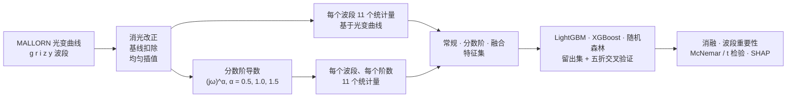
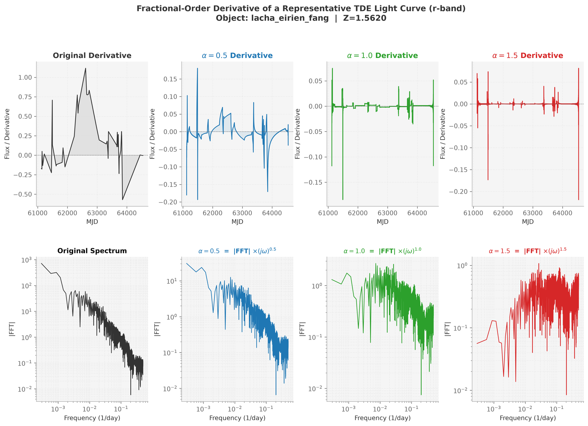
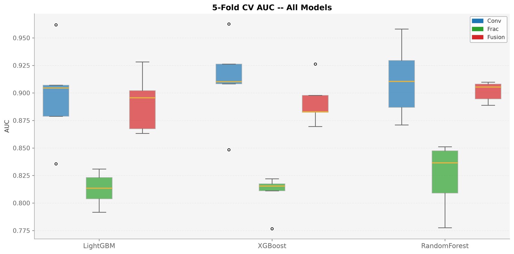
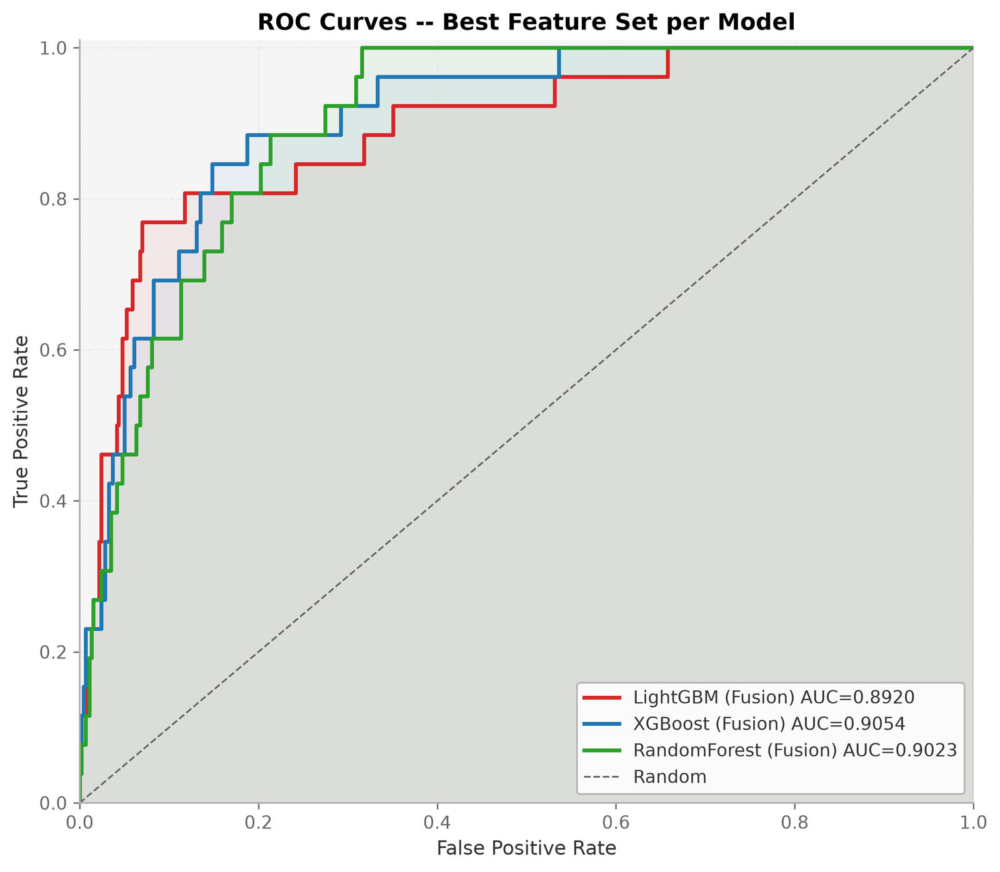
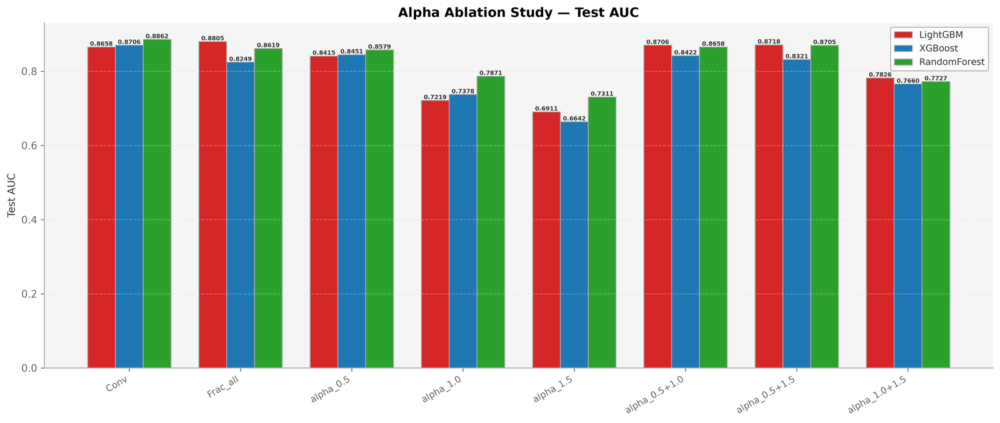
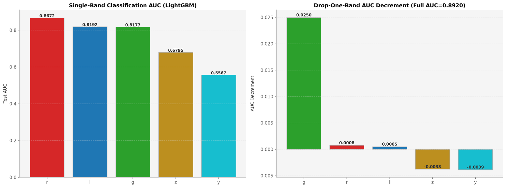
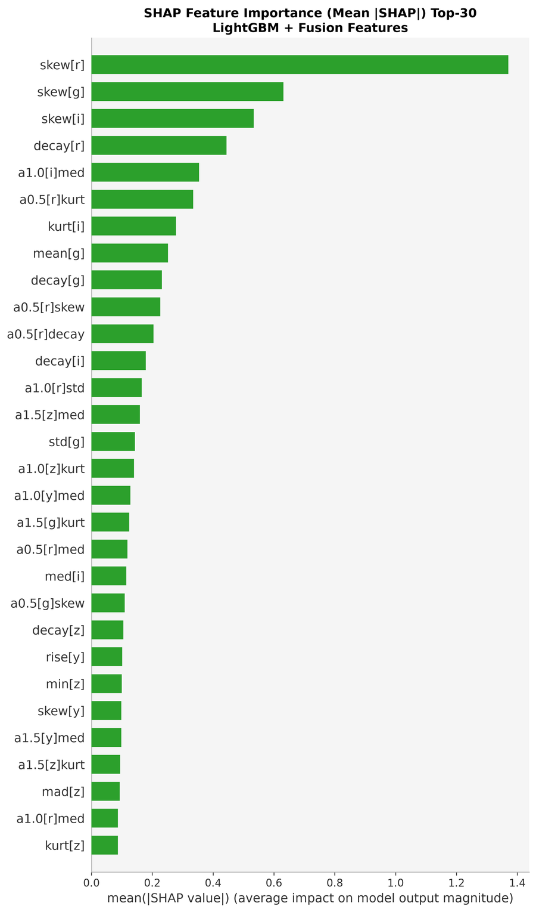

# 用分数阶特征进行 TDE 光变曲线分类

[English](README.md) | **简体中文**

本仓库是我的本科毕业论文《基于分数阶微分的核瞬变源光变曲线特征提取与分类研究》（2026）的研究代码。

**研究问题。** 潮汐瓦解事件（TDE）是恒星被大质量黑洞撕裂时产生的暂现源，在核暂现源中占比很低，因此测光分类是一个类别极不平衡的学习问题。光变曲线的分数阶导数，能否捕捉到常规统计量遗漏的时间结构，比如上升和衰减的形态？

**方法。** 使用 MALLORN 数据集中模拟的 LSST 光变曲线。每个波段的光变曲线先做消光改正、基线扣除，再插值到均匀时间网格上。分别在光变曲线本身及其 α ∈ {0.5, 1.0, 1.5} 阶分数阶导数上计算 11 个统计量（各阶矩、振幅、上升与衰减时间等），分数阶导数在频域中以 `(jω)^α` 计算。随后在常规、分数阶和融合三种特征集上比较 LightGBM、XGBoost 和随机森林，并做消融实验、统计检验和 SHAP 分析。

**简要结论。** 在留出测试集上，三种模型都是融合特征的 AUC 最高，SHAP 分析中分数阶特征也位列重要特征之中。但在五折交叉验证下，只用常规特征的表现与融合特征相当，因此分数阶特征带来的增益还不能算作已被证实。2026 年 11 月用当前版本的依赖库做了复现，主要结果得到确认，但部分消融结论没有复现（见[结果](#结果)）。





*一条典型 TDE 光变曲线（r 波段）及其分数阶导数。阶数越高，高频结构被放大得越明显；α = 0.5 则保留了更多缓慢的上升和衰减形态。*

## 结果

清洗后，3,043 个带标签天体中有 2,423 个具有可用的光变曲线（TDE 占 5.4%）。u 波段因 80% 以上的特征缺失而被剔除，最终使用 5 个波段。所有结果都基于分层的 80/20 留出划分（测试集 485 个天体，其中 26 个 TDE）和分层五折交叉验证，随机种子为 42。

### 论文结果与复现结果

论文结果产生于 2026 年 5 月。2026 年 11 月，在同一份数据上用完全相同的代码、当前版本的依赖库重新运行，环境锁定在 [`requirements-lock.txt`](requirements-lock.txt)。除特别说明外均为 LightGBM 的结果。

| 结论 | 论文（2026 年 5 月） | 复现（2026 年 11 月） | 是否成立 |
| --- | --- | --- | --- |
| 融合特征：准确率 / AUC | 94.02% / 0.8850 | 94.43% / 0.8920 | 成立 |
| 与常规特征相比，融合特征降低了五折交叉验证 AUC 的波动 | 标准差 ≈ 0.09 → ≈ 0.03 | 标准差 0.041 → 0.024 | 成立，但幅度更小 |
| 三种模型之间无显著差异（McNemar 检验，融合特征） | p > 0.05 | p ≥ 0.45 | 成立 |
| 最佳分数阶组合：α = 0.5 + 1.0（110 维）优于三阶全用（165 维） | AUC 0.8953 vs 0.8869 | AUC 0.8706 vs 0.8805 | 不成立：三阶全用最好 |
| 去掉 r 波段造成的 AUC 损失最大 | −0.0361 | −0.0008；去掉 g 波段损失 −0.0250 | 不成立 |
| r 是单独使用时最强的波段 | 是 | 是（AUC 0.8672） | 成立 |

代码完全相同，因此差异最可能来自运行环境：依赖库版本会改变树模型的构建方式，也可能改变数据行顺序，进而改变留出集的划分。测试集里只有 26 个 TDE，几个样本就可能让 AUC 变化 0.01–0.03，所以单次划分上这种量级的消融差异不宜视为定论。

### 留出集与交叉验证（复现）

| 模型 | 特征集 | 特征数 | 留出集 AUC | 五折交叉验证 AUC（均值 ± 标准差） |
| --- | --- | ---: | ---: | ---: |
| LightGBM | 常规 | 55 | 0.866 | 0.898 ± 0.041 |
| LightGBM | 分数阶 | 165 | 0.881 | 0.813 ± 0.014 |
| LightGBM | **融合** | 220 | **0.892** | 0.891 ± 0.024 |
| XGBoost | 常规 | 55 | 0.871 | 0.911 ± 0.037 |
| XGBoost | 分数阶 | 165 | 0.825 | 0.809 ± 0.016 |
| XGBoost | **融合** | 220 | **0.905** | 0.892 ± 0.019 |
| 随机森林 | 常规 | 55 | 0.886 | 0.911 ± 0.031 |
| 随机森林 | 分数阶 | 165 | 0.862 | 0.824 ± 0.028 |
| 随机森林 | **融合** | 220 | **0.902** | 0.901 ± 0.008 |

在留出集上，每个模型都是融合特征最好；但在交叉验证中，常规特征与融合特征持平甚至更好。要确认分数阶特征的增益，下一步应采用重复或嵌套的评估，并使用更多 TDE 样本。

<table>
<tr>
<td></td>
<td></td>
</tr>
<tr>
<td><em>各模型在常规、分数阶和融合特征上的五折交叉验证 AUC。</em></td>
<td><em>留出集 ROC 曲线，每个模型取最佳特征集。</em></td>
</tr>
</table>

### 消融与可解释性（复现）



*不同分数阶组合的留出集 AUC。α = 0.5 单独使用时就承载了大部分信号；单独使用 α = 1.0 或 1.5 则明显更弱。*



*左：只用单个波段时的 AUC。右：从融合特征中去掉某个波段后损失的 AUC。*



*LightGBM 在融合特征上的平均 |SHAP|。r、g、i 波段光变曲线的偏度最重要，其后是常规的衰减时间特征和分数阶特征（前缀为 `a0.5`、`a1.0`、`a1.5`）交替出现。*

## 仓库结构

```text
.
├── scripts/
│   ├── run_experiments.py         # 主模型对比与错误分析
│   ├── run_ablation_analysis.py   # alpha、波段、阈值和统计分析
│   ├── run_interpretability.py    # 分数阶示例、相关性和 SHAP
│   ├── 00_preprocess.py           # 独立的分步预处理工具
│   ├── 01_eda.py                  # 基于分步预处理结果的 EDA
│   └── 02_feature_extraction.py   # 实验性 GL 分数阶特征提取器
├── archive/                        # 用于追溯的早期实验脚本
├── result/                         # 生成结果；Git 仅追踪目录说明
├── DATA.md                         # 数据来源、目录和校验说明
├── CITATION.cff                    # 引用元数据
├── LICENSE                         # 当前使用条款
├── docs/figures/                   # 2026 年 11 月复现生成的图表
├── requirements.txt                # Python 依赖（版本下限）
└── requirements-lock.txt           # 复现时的完整环境
```

## 环境安装

建议使用 64 位 Python 3.10 或更高版本，并从仓库根目录运行所有命令。

```bash
python -m venv .venv
```

Windows PowerShell：

```powershell
.venv\Scripts\Activate.ps1
python -m pip install --upgrade pip
python -m pip install -r requirements.txt
```

macOS 或 Linux：

```bash
source .venv/bin/activate
python -m pip install --upgrade pip
python -m pip install -r requirements.txt
```

实验会加载完整光变数据、并行训练多个模型并生成高分辨率图片，请预留足够的内存、磁盘空间和运行时间。

## 数据准备

项目使用 MALLORN Astronomical Classification Challenge 数据。本仓库不重新分发数据，请从官方来源下载，并按照 [DATA.md](DATA.md) 建立以下目录：

```text
mallorn-dataset/train_log.csv
mallorn-dataset/split_01/train_full_lightcurves.csv
...
mallorn-dataset/split_20/train_full_lightcurves.csv
```

在 PowerShell 中快速检查：

```powershell
Test-Path mallorn-dataset/train_log.csv
(Get-ChildItem mallorn-dataset/split_*/train_full_lightcurves.csv).Count
```

预期输出分别为 `True` 和 `20`。

## 运行分析

三个主要入口彼此独立，都会自行加载和预处理原始数据，因此不需要按顺序全部执行。

| 命令 | 主要输出 |
| --- | --- |
| `python scripts/run_experiments.py` | `result/eda/`、`result/viz/` 和 `result/error_analysis/` 中的模型指标与图表 |
| `python scripts/run_ablation_analysis.py` | `result/analysis/` 中的消融、波段、统计检验和阈值结果 |
| `python scripts/run_interpretability.py` | `result/analysis/` 中的分数阶、相关性和 SHAP 图表 |

解释性分析会将可复用特征保存到 `result/analysis/feature_cache.pkl`。修改数据或特征生成逻辑后，应先删除该缓存再重新运行。

### 分步工具流程

仓库还保留了一套较早的分步工具：

```bash
python scripts/00_preprocess.py
python scripts/01_eda.py
python scripts/02_feature_extraction.py
```

`02_feature_extraction.py` 使用离散 Grünwald–Letnikov（GL）分数阶导数，并采用不同的 `alpha` 集合。它是方法对照工具，不是 FFT 主流程的等价拆分，也不会被 `run_*.py` 自动调用。

## 可复现性与限制

- 训练/测试划分和模型训练使用固定随机种子 `42`，绘图抽样也使用固定种子。
- `requirements.txt` 给出兼容下限；[`requirements-lock.txt`](requirements-lock.txt) 锁定了 2026 年 11 月复现时的完整环境（Python 3.12，Windows）。论文原始运行的环境没有记录，两者的结果有差异，详见[结果](#结果)。
- 带标签训练集包含 3,043 个天体，其中 148 个为 TDE，类别明显不平衡。因此应结合 AUC 和混淆矩阵解读 Accuracy。
- 脚本使用类别权重、固定的分层留出划分和五折交叉验证。
- 当前属于探索性数据科学代码，尚无命令行配置层、自动数据下载器、单元测试或持续集成流程。
- 相对路径以当前工作目录为基准，请从仓库根目录运行脚本。

## 常见问题

- **`FileNotFoundError: mallorn-dataset/...`**：检查 [DATA.md](DATA.md) 中的目录结构，并确认命令从仓库根目录启动。
- **`No objects to concatenate`**：脚本没有找到 20 个 `split_*/train_full_lightcurves.csv` 文件。
- **LightGBM 或 XGBoost 安装失败**：升级 `pip`，确认使用受支持的 64 位 Python，并在干净的虚拟环境中重试。
- **辅助 EDA 图提示缺少中文字体**：`01_eda.py` 使用 SimHei 字体，仅影响图中文字，不影响模型结果。
- **解释性分析结果未更新**：删除 `result/analysis/feature_cache.pkl` 后重新运行 `run_interpretability.py`。

## 引用

如果本仓库对你的工作有帮助，请使用 GitHub 的 **Cite this repository** 功能，并引用 MALLORN 数据论文。仓库引用元数据见 [CITATION.cff](CITATION.cff)，数据引用见 [DATA.md](DATA.md)。

## 许可

本仓库目前仅供查看、学术交流和引用，尚未授予开源许可。在复制、修改、重新分发代码或基于本项目提交贡献前，请先阅读 [LICENSE](LICENSE)。
